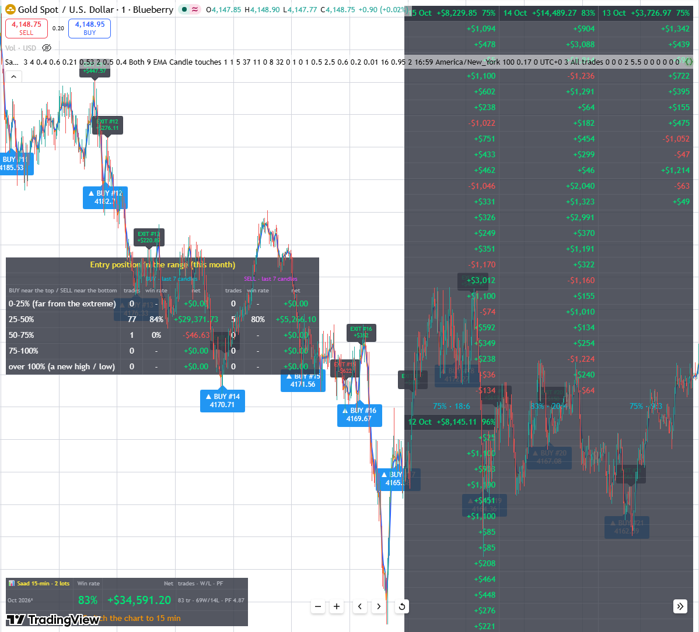
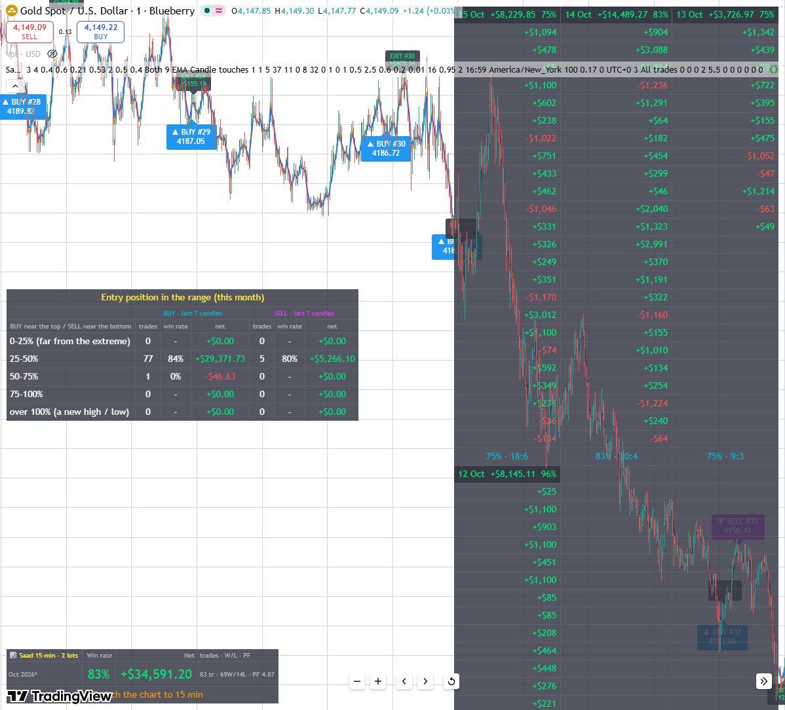
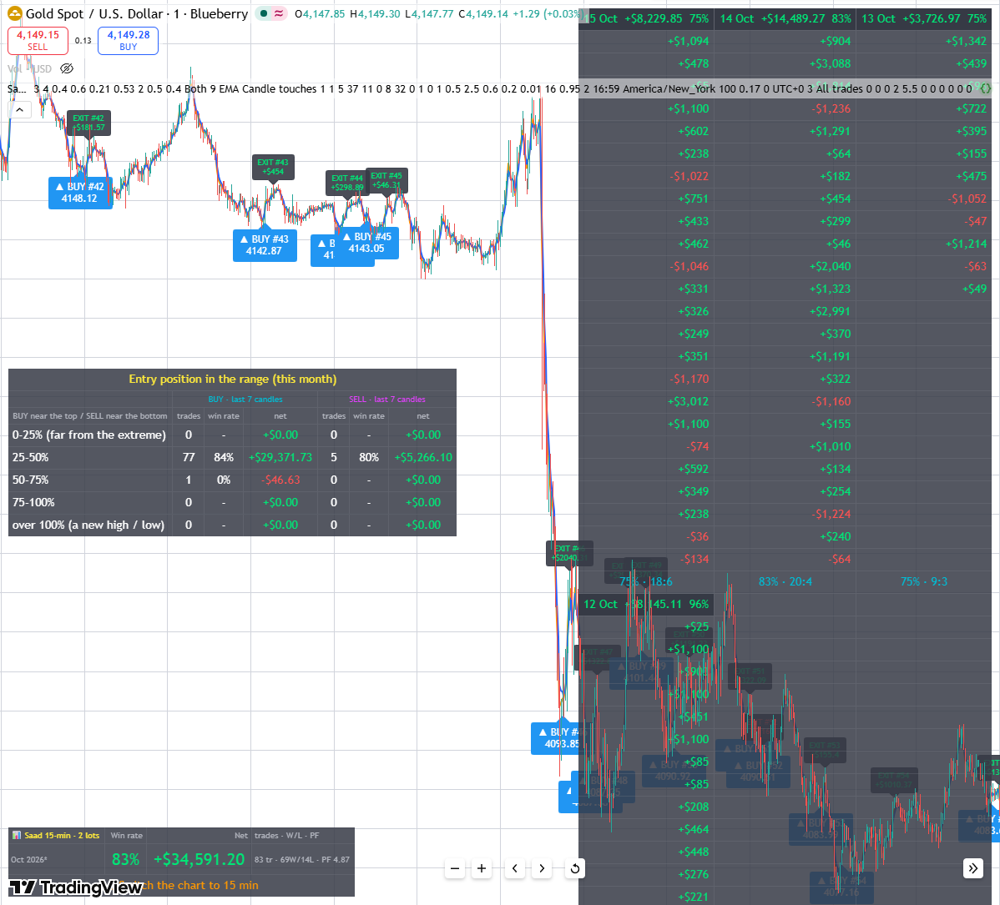
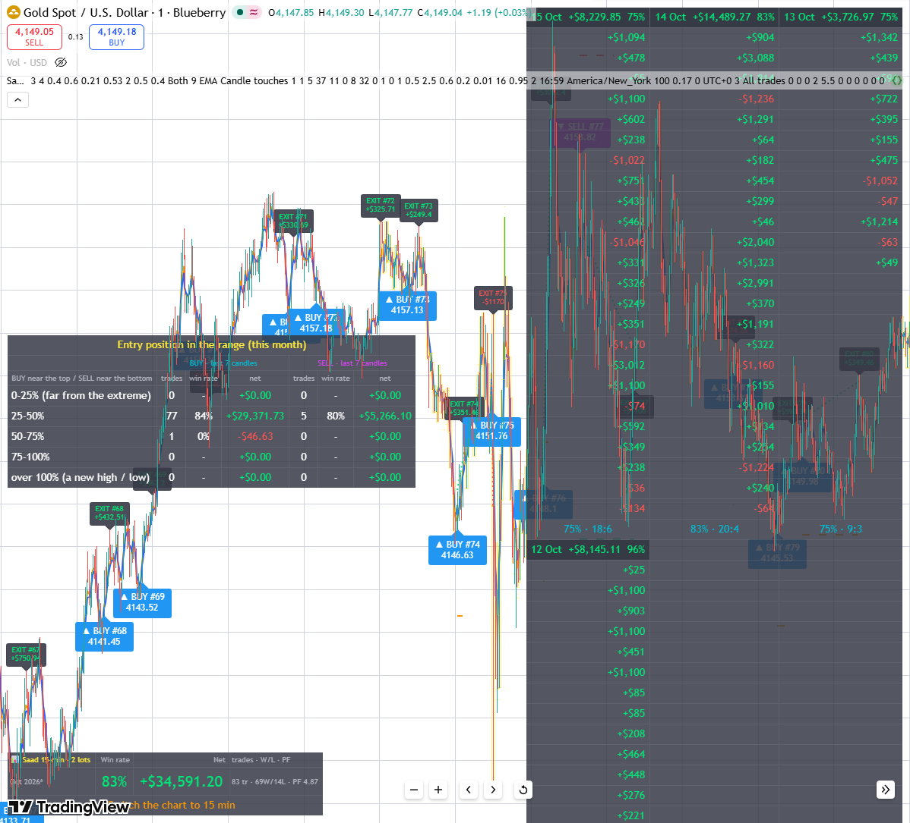
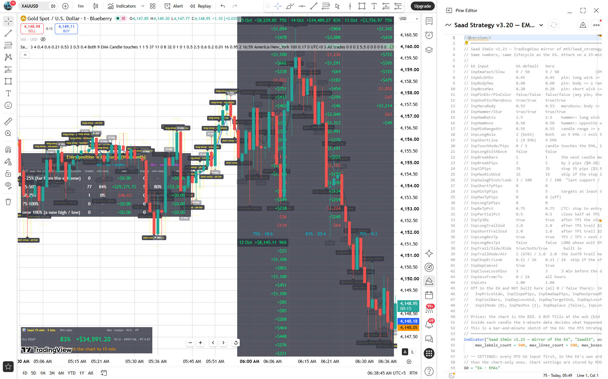

# Saad strategy 1-min - optimized TradingView settings

Saved 16 Oct 2026 06:36 (PKT) from Zee's chart **BLUEBERRY:XAUUSD, 1-minute**, indicator **Saad 15min v1.23 — mirror of the EA** (TradingView script "Saad Strategy v3.20 — EMA 9/50 pin & marubozu").

## What these settings showed on the chart

| | |
|---|---|
| October (chart history: 11-16 Oct on 1-min) | 83 trades · 83% win rate · +$34,591.20 · PF 4.87 (2 lots) |
| 12 Oct | +$8,145.11 · 96% (22:1) |
| 13 Oct | +$3,726.97 · 75% (9:3) |
| 14 Oct | +$14,489.27 · 83% (20:4) |
| 15 Oct | +$8,229.85 · 75% (18:6) |
| BUY entries (25-50% of last 7) | 77 trades · 84% · +$29,371.73 |
| SELL entries (30-35% of last 7) | 5 trades · 80% · +$5,266.10 |

Chart figures are the indicator's sketch; check any change in MT5 with the compare page (`monitor/saad_compare`, http://127.0.0.1:8772) before trading it.

## Files in this folder

| File | What it is |
|---|---|
| `saad_15min_indicator.pine` | the indicator code, exactly as on the chart - paste into the Pine Editor to rebuild it |
| `indicator_settings.json` | every setting: position (`in_N`), name, value, default - to restore by script |
| `Saad_strategy_1min_optimized.set` | the same settings as MT5 inputs for `Saad_strategy_1min.mq5` (EA properties → Inputs → Load) |
| `Saad_strategy_1min.mq5` | the EA these settings drive (v1.02) |
| `screenshots/` | the chart with these settings |

## Screenshots

**2026-10-12**

**2026-10-13**

**2026-10-14**

**2026-10-15**

**2026-10-16 (whole window)**

## How to restore on TradingView

1. Pine Editor → open "Saad Strategy v3.20 — EMA 9/50 pin & marubozu" (or a new script) → paste `saad_15min_indicator.pine` → Save → Add to chart.
2. Set each value below in the indicator's settings (or ask Claude to apply `indicator_settings.json` by position).
3. Chart: BLUEBERRY:XAUUSD, 1 minute.

**Bold** = changed from the code's default.

### EA · EMAs

| # | Setting | Value | Default |
|---|---|---|---|
| in_0 | InpEmaFast | **3** | 9 |
| in_1 | InpEmaSlow | **4** | 50 |

### EA · ① setup candle

| # | Setting | Value | Default |
|---|---|---|---|
| in_2 | InpWickMin — pin: long wick >= x range | **0.4** | 0.45 |
| in_3 | InpBodyMax — pin: body <= x range | 0.6 | 0.60 |
| in_4 | InpNoseMax — pin: short wick <= x range | **0.21** | 0.20 |
| in_5 | InpPinDir — pin must point the trade way | false | false |
| in_6 | InpPinColor — pin body must close the trade way (with PinDir) | false | false |
| in_7 | InpUsePin — accept pin bars | true | true |
| in_8 | InpMarubozu — accept a marubozu | true | true |
| in_9 | InpMaruBody — marubozu: body >= x range | 0.53 | 0.53 |
| in_10 | InpHammer — accept hammers (LONG) | true | true |
| in_11 | InpStar — accept shooting stars (SHORT) | true | true |
| in_12 | InpHamRatio — hammer: long wick >= x body | **2** | 2.5 |
| in_13 | InpHamNose — hammer: opposite wick <= x range | 0.5 | 0.50 |
| in_14 | InpMinRangeAtr — candle range >= x ATR(14) (0 = off) | **0.4** | 0.55 |

### EA · ① on the EMA

| # | Setting | Value | Default |
|---|---|---|---|
| in_15 | InpLongRule — LONG setups | Both | Both |
| in_16 | InpShortLine — SHORT setups on | 9 EMA | 9 EMA |
| in_17 | InpTouchMode | Candle touches | Candle touches |
| in_18 | InpTouchPips — touch tolerance | 1 | 1 |
| in_19 | InpLongExitAbove — LONG only when its exit EMA is above the candle | false | false |

### EA · ② break · ③ entry · ④ stop

| # | Setting | Value | Default |
|---|---|---|---|
| in_20 | InpBreakBars — candles allowed for the break | 1 | 1 |
| in_21 | InpBreakPips — break must clear the high / low by | **5** | 2 |
| in_22 | InpSlPips — stop beyond the candle | **37** | 35 |
| in_23 | InpMaxRiskUsd — skip if the stop is more than $ away (0 = off) | **11** | 15 |

### EA · ⑤ targets

| # | Setting | Value | Default |
|---|---|---|---|
| in_24 | InpLongTpPips — LONG TP this many pips before the EMA | 0 | 0 |
| in_25 | InpSwingPivot — candles each side of a swing | **8** | 3 |
| in_26 | InpSwingLook — candles back to search | **32** | 100 |
| in_27 | InpShortTpPips — SHORT TP this many pips before the support | 0 | 0 |
| in_28 | InpMinTpPips — target at least this far | **1** | 5 |
| in_29 | InpMaxTpPips — skip a SHORT whose support is further (0 = off) | 0 | 0 |

### EA · ⑥ CTC · ⑦ trail · day close

| # | Setting | Value | Default |
|---|---|---|---|
| in_30 | InpCloseLossMins — this many min before the close shut trades in loss (0 = off) | **1** | 3 |
| in_31 | InpLongTrailUsd — after TP1 trail $ below the market | **0.5** | 2.0 |
| in_32 | InpShortTrailUsd — after TP1 trail $ above the market | **2.5** | 2.0 |
| in_33 | InpBeTpPct — CTC: stop to entry at this share of the way to TP1 (0 = off) | **0.6** | 0.75 |
| in_34 | InpTrailAtr — no-TP1 LONG: trail x ATR behind the best price | **0.2** | 2.0 |

### EA · ✖ filters

| # | Setting | Value | Default |
|---|---|---|---|
| in_35 | InpChopEr — skip if the efficiency ratio is below (0 = off) | **0.01** | 0.11 |
| in_36 | InpChopErLook — efficiency ratio length | 16 | 16 |
| in_37 | InpGapCancel — cancel a waiting setup across the daily close / weekend | true | true |

### EA · partial · money · display

| # | Setting | Value | Default |
|---|---|---|---|
| in_38 | InpPartialPct — close this share at TP1 | **0.95** | 0.5 |
| in_39 | InpTp1Be — after TP1 the stop is never worse than the entry | true | true |
| in_40 | InpLots | **2** | 1.0 |
| in_41 | InpBuys | true | true |
| in_42 | InpSells | true | true |
| in_43 | InpDrawSkips — also label skipped setups | **true** | false |

### CHART ONLY (not in the EA)

| # | Setting | Value | Default |
|---|---|---|---|
| in_44 | Day close (EA reads it from the broker: PXBT 20:59, Axi 23:59 = 4:59 PM New York) | 16:59 | 16:59 |
| in_45 | Day close timezone | America/New_York | America/New_York |
| in_46 | Contract size ($ per $1 per lot) | 100 | 100 |
| in_47 | Spread, $ of price (PXBT XAUUSDp 0.17) | 0.17 | 0.17 |
| in_48 | Commission per lot, round trip $ | 0 | 0 |
| in_49 | Show the stats panel | true | true |
| in_50 | Write every setup / entry / stop move / exit to the Pine Logs | false | false |
| in_51 | Draw labels only up to this time (0 = all; TradingView keeps the newest 500 labels) | 0 | 0 |
| in_52 | Show today's trades box (top right) | true | true |
| in_53 | Today's trades box: MT5 server timezone (PXBT = UTC+0) | UTC+0 | UTC+0 |
| in_54 | Detail tags (setups, skips, BE/TP, exit X) only for the last N days - TradingView keeps 500 labels, so the BUY/SELL + EXIT labels of the whole month always fit | 3 | 3 |
| in_55 | Skip a setup candle that touches BOTH EMAs (9 and 50) - not in the EA | false | false |
| in_56 | Tight trail: when InpTrailAtr would put the stop above the price, put it 1 pip under the candle close instead of not moving it - not in the EA yet | false | false |

### STOP NEAR PEAK (chart-only, not in the EA yet)

| # | Setting | Value | Default |
|---|---|---|---|
| in_57 | Apply to | **All trades** | No-TP1 longs only |
| in_58 | Start: giveback / $ trail / ATR / candle / EMA only once the trade is this many $ in profit | 0 | 0 |
| in_59 | ① Breakeven: stop to the entry once $X in profit (0 = off) | 0 | 0 |
| in_60 |     ...and lock this many $ beyond the entry | 0 | 0 |
| in_61 | ② Lock: once $X in profit... (0 = off) | **2** | 0 |
| in_62 |     ...lock the stop this many $ beyond the entry | **5.5** | 0 |
| in_63 | ③ Ladder (with ②): every further $X of profit raises the lock by $X (0 = off) | 0 | 0 |
| in_64 | ④ Giveback: keep (100 - X)% of the best profit, e.g. 30 = give back 30% (0 = off) | 0 | 0 |
| in_65 | ⑤ $ trail: stop this many $ behind the best price (0 = off) | 0 | 0 |
| in_66 | ⑥ ATR trail: stop this many x ATR behind the best price (0 = off) | 0 | 0 |
| in_67 | ⑦ Candle trail: stop under the lowest low of the last N closed candles (0 = off) | 0 | 0 |
| in_68 | ⑧ EMA trail: stop 1 pip under this EMA of the closed candle (0 = off) | 0 | 0 |
| in_69 | ⑨ ATR-trail gap: when InpTrailAtr moves the stop, keep it at least $X under the candle close (0 = off) | **0.1** | 0 |

### ENTRY + CUT LOSERS EARLY (chart-only, not in the EA yet)

| # | Setting | Value | Default |
|---|---|---|---|
| in_70 | Entry: wick break of the setup candle, or wait for a candle CLOSE beyond it (enter at the next open) | Wick break (EA) | Wick break (EA) |
| in_71 | Cut: N candles in a row against the trade while in loss -> close at the next open (0 = off) | **6** | 0 |
| in_72 | Cut: still in loss after N candles -> close at the next open (0 = off) | 0 | 0 |
| in_73 | Cut: a candle closes beyond the slow EMA against the trade while in loss -> close at the next open | false | false |
| in_74 | Cut: max loss - stop no further than $X from the entry (0 = off, the EA's stop) | 0 | 0 |

### TOP / BOTTOM FILTER (chart-only, not in the EA yet)

| # | Setting | Value | Default |
|---|---|---|---|
| in_75 | BUY: range = the last N closed candles | **7** | 20 |
| in_76 | BUY: skip entering ABOVE X% of that range (0 = off; over 100 = a new high) | **50** | 0 |
| in_77 | Show the diagnostics table: this month's trades by how near the top (BUY) / bottom (SELL) they entered | **true** | false |

### COOL-DOWN AFTER AN EXIT (chart-only, not in the EA yet)

| # | Setting | Value | Default |
|---|---|---|---|
| in_78 | No new trade for N candles after a trade closes (0 = off; 2 = the exit candle + the next 2) | 0 | 0 |
| in_79 | ...blocks | **Both directions** | Same direction |
| in_80 | ...only after a WINNING exit | false | false |

### FAILED ENTRY EXIT (chart-only, not in the EA yet)

| # | Setting | Value | Default |
|---|---|---|---|
| in_81 | Exit when the candle AFTER the entry candle closes beyond it: BUY below its low, SELL above its open/high -> out at the next open | false | false |
| in_82 | ...SELL: the line it must close above | Entry candle's open | Entry candle's open |

### TRADES BOX DATE RANGE (chart-only)

| # | Setting | Value | Default |
|---|---|---|---|
| in_83 | Top-right box: list the trades closed from this date (0 = today + yesterday) | 0 | 0 |
| in_84 | ...up to this date (0 = now) | 0 | 0 |

### TOP / BOTTOM FILTER (chart-only, not in the EA yet)

| # | Setting | Value | Default |
|---|---|---|---|
| in_85 | BUY: skip entering BELOW X% of the range (0 = off; with the max = keep only a band, e.g. 25-55) | **25** | 0 |

### CHART ONLY (not in the EA)

| # | Setting | Value | Default |
|---|---|---|---|
| in_86 | Detail tags (setups, skips, BE/TP, exit X): keep at most N - the rest of TradingView's 500 labels stays for BUY / SELL / EXIT | 200 | 200 |

### TRADES BOX DATE RANGE (chart-only)

| # | Setting | Value | Default |
|---|---|---|---|
| in_87 | Trade export table (bottom centre): every trade with entry / exit times (UTC), for comparing with MT5 - uses the date range above, else all trades | false | false |

### TOP / BOTTOM FILTER (chart-only, not in the EA yet)

| # | Setting | Value | Default |
|---|---|---|---|
| in_88 | TOP / BOTTOM · SELL: range = the last N closed candles | **7** | 20 |
| in_89 | TOP / BOTTOM · SELL: skip entering LOWER than X% from the top of that range (0 = off; over 100 = a new low) | **35** | 0 |
| in_90 | TOP / BOTTOM · SELL: skip entering HIGHER than X% from the top (0 = off; with the max = keep only a band) | **30** | 0 |
