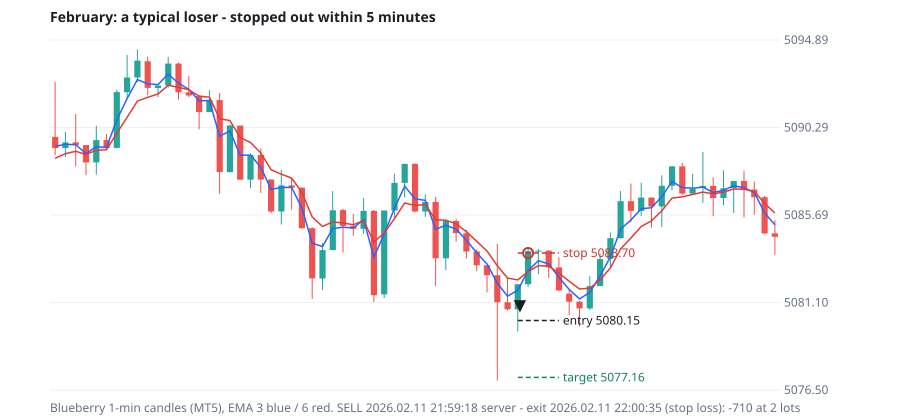
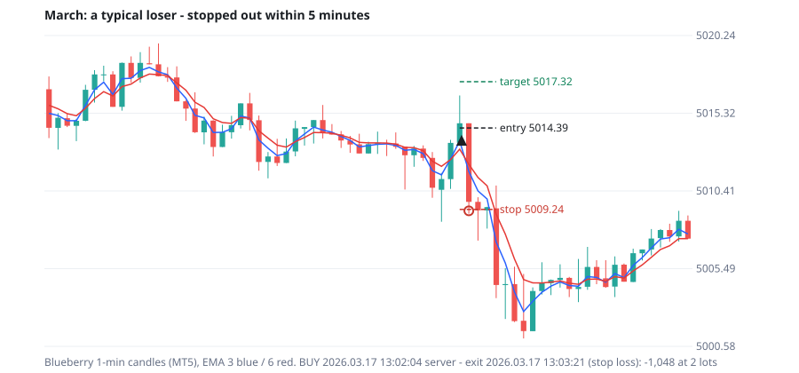
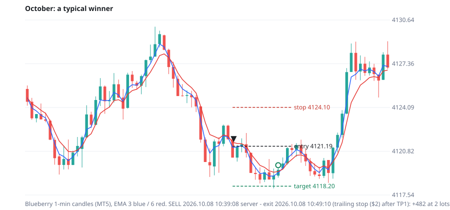
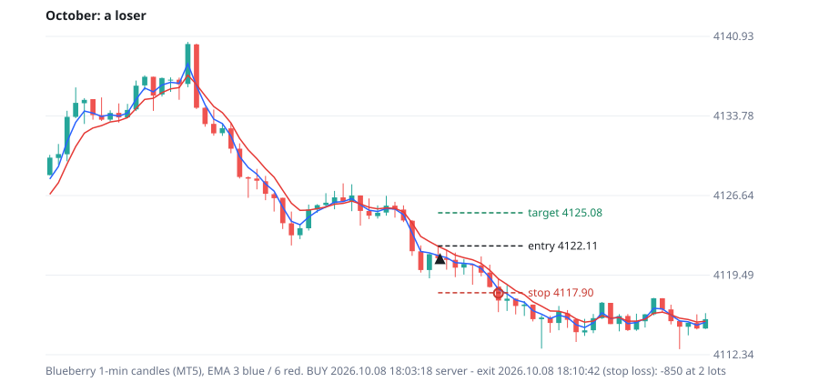

# Task 4 — why the 1-min setups look great in October and fail in other months

*Zee, 2026-10-18: "By scrolling the chart on 1 min timeframe with the indicator applied -> find out (debug) the reason why the setups might fail on other months when doing so well on october chart."*

## First: why the chart can't be scrolled back

On 1 minute, TradingView only gives this chart **about one week of history** (the export got 6,898 one-minute candles, Oct 12 – 16, even after asking the chart for more 15 times).

So instead of scrolling, I used:
- **MT5's own 1-minute Blueberry candles for Jan 1 – Oct 16.** They're built from Blueberry's real ticks, the same feed as BLUEBERRY:XAUUSD.
- **The trades the EA really takes on those candles,** from the MT5 Strategy Tester.

The setup studied is the one closest to the current chart from the 40-setup year run: stop 13 pips beyond the setup candle, fixed $3 target, EMA 3/6, max risk $10.

## Finding 1 — gold in October was the quietest it has been all year

| Month | Average 1-min candle | Average day range | Trades | Win rate | PF | **Losers stopped out within 5 minutes** |
|---|---|---|---|---|---|---|
| Jan | $3.20 | $138 | 2,768 | 58.3% | 0.98 | 56% |
| Feb | **$4.06** | $154 | 3,355 | 59.4% | 0.88 | **70%** |
| Mar | **$4.09** | **$166** | 4,142 | 61.3% | 0.96 | **71%** |
| Apr | $2.56 | $105 | 3,067 | 56.4% | 0.86 | 56% |
| May | $2.20 | $85 | 2,739 | 56.6% | 0.90 | 54% |
| Jun | $2.36 | $101 | 3,067 | 58.0% | 0.94 | 55% |
| Jul | $1.84 | $78 | 2,568 | 55.3% | 0.91 | 45% |
| Aug | $2.02 | $88 | 2,594 | 56.6% | 0.91 | 45% |
| Sep | $1.99 | $83 | 2,715 | 55.9% | 0.93 | 49% |
| **Oct 1–16** | **$1.62** | **$61** | 1,183 | 54.0% | 0.90 | **39%** |

In **February and March a single 1-minute candle was about 2.5× bigger** than in October, and the day's range was nearly 3× wider.

## Finding 2 — the settings are written in fixed dollars, so they fit only October's volatility

Almost every exit and risk setting on the chart is a **fixed dollar amount or a fixed number of pips**:
- TP1 $2.50
- max risk $4.50
- trails $1 / $1.50
- lock and breakeven levels in $
- stop "15 pips beyond the setup candle"

They were tuned while watching **October**, the calmest month.

In a month like February the same numbers mean something completely different:
- **The stop is a normal wiggle.** In February **70% of all losers were stopped out within 5 minutes**; in October only 39% were. These aren't wrong-direction trades, they're noise stop-outs (examples below).
- **The max-risk filter changes what it lets through.** With bigger candles the stop distance is bigger, so a fixed $4.50 cap skips different trades every month.
- **The dollar target is a different size every month.** $2.50 is a big move in October and less than one candle in March.

## Finding 3 — about a third of the losers were already in profit

**29–36% of the losers were +$1.50 or more in profit first**, then turned and hit the stop. Every month looks like this, October included. It's an exit-timing issue (targets and trails in fixed $), separate from the entry.

## Finding 4 — MT5 doesn't see a great October either

For this setup, MT5's October (PF 0.90) is **no better than the other months**. The chart's October result comes from:
- the chart's own week, Oct 12–16
- the chart's simpler fills: a fixed $0.17 spread and no slippage
- settings picked by watching exactly those trades

So October isn't special for the strategy. **The chart week is special because the settings were fitted to it.**

## See it: real trades on their candles

| | |
|---|---|
|  |  |
|  |  |

*February SELL: stopped out after 77 seconds (−$710). March BUY: stopped out after 77 seconds (−$1,048). Both stops sit inside one normal candle of that month. October SELL winner (+$482), October BUY loser after 7 minutes (−$850).*

## What follows from this — what to test (in MT5, not by eye)

1. **Volatility-scaled settings instead of dollar settings:**
   - stop = ATR × multiple (the EA has `InpSlMode` 1)
   - TP1 = Fibonacci of the setup candle (scales with the candle) or ATR × multiple
   - trails in ATR, not $

   Then a February candle and an October candle get treated in proportion. On 15 minutes this exact change (ATR stop 2.5×) made every month green.
2. **A volatility gate:** trade 1 minute only when the 1-min ATR is inside the band the settings were built for. October-like days only, sitting out February-like chaos.
3. **Never judge a 1-min setting on the chart week alone.** The chart can only show a quiet week right now. Task 5 (MT5, every setting over the full year) is the honest version, and the Task 3 file puts the two side by side.

*Data: MT5 Strategy Tester (Saad_strategy_1min v1.34, XAUUSD_BB real ticks, M1, Jan 1 – Oct 16 2026, no delay). Market numbers from MT5's own M1 candles. Example charts: `monitor/saad_compare/task4_examples.py`.*
